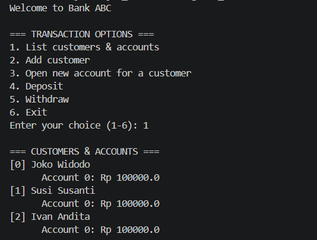

# Bank System Simulation

This is a simple Java-based console application that simulates a basic banking system. The project demonstrates core Object-Oriented Programming (OOP) concepts, including classes, encapsulation, static variables, and the practical implementation of both standard Java Arrays and dynamic ArrayLists.

## 📸 Screenshot
  

Program Output

## 📚 Array vs. ArrayList Implementation
This project specifically highlights the difference between fixed-size and dynamic data structures in Java:

*   **Array Example (`Bank.java`):** The `Bank` class uses a standard, fixed-size Java Array to store customers (`private Customer[] customers;`). This creates a strict limit for the bank, accommodating a maximum of 10 customers as defined by the constant `MAX_CUSTOMERS`.
*   **ArrayList Example (`Customer.java`):** The `Customer` class uses a dynamic `ArrayList` to manage user accounts (`private ArrayList<Account> accounts = new ArrayList<Account>();`). Unlike the fixed array, this allows a single customer to open any number of accounts without hitting a predefined maximum limit.

## 🛠 Libraries and Dependencies
This project does not require any external, third-party libraries (like Maven or Gradle dependencies). It relies entirely on built-in Java standard utilities:
*   `java.util.ArrayList`: Imported in `Customer.java` to handle the dynamic list of bank accounts.
*   `java.util.Scanner`: Imported in `BankDemo.java` to read interactive user input from the console.

## 🚀 Features
*   **Add Customers:** Register new customers to the bank via the console interface until the array limit is reached.
*   **Manage Accounts:** Open multiple new accounts with custom initial balances for any registered customer.
*   **Process Transactions:** Deposit to and withdraw from specific customer accounts using an interactive menu.
*   **Global Transaction Tracking:** A static counter (`totalTransaction`) keeps track of the total number of successful deposits and withdrawals completed across all accounts during the session.
*   **Seed Data Generation:** The application automatically initializes with 3 sample customers (Joko Widodo, Susi Susanti, Budi Santoso), each starting with one account containing a balance of Rp 100,000.

## 💻 How to Run
1.  Ensure you have the Java Development Kit (JDK) installed on your system.
2.  Open your terminal or command prompt and navigate to the folder containing the `.java` files.
3.  Compile all the Java files using the following command:
    ```bash
    javac Account.java Bank.java Customer.java BankDemo.java
    ```
4.  Run the main demo application:
    ```bash
    java BankDemo
    ```