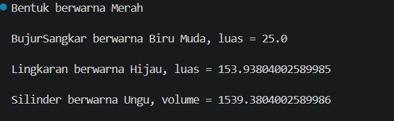

# Inheritance and Polymorphism in Java

A small Java project (package `Inheritance_and_polymorphism`) that demonstrates three core Object-Oriented Programming concepts: **encapsulation**, **inheritance**, and **polymorphism**, using geometric shapes.

## Project Structure

```
Inheritance_and_polymorphism/
├── Bentuk.java         # Parent (base) class
├── BujurSangkar.java   # Child of Bentuk (square)
├── Lingkaran.java      # Child of Bentuk (circle)
├── Silinder.java       # Child of Lingkaran (cylinder)
└── Main.java           # Program entry point
```

## Class Hierarchy

```
Bentuk
├── BujurSangkar
└── Lingkaran
    └── Silinder
```

| Class | Extends | Own attribute | Own method |
|---|---|---|---|
| `Bentuk` | - | `warna` | `printInfo()` |
| `BujurSangkar` | `Bentuk` | `sisi` | `hitungLuas()` |
| `Lingkaran` | `Bentuk` | `radius` | `hitungLuas()` |
| `Silinder` | `Lingkaran` | `tinggi` | `hitungVolume()` |

---

## 1. Encapsulation

Encapsulation means hiding the internal data of a class behind `private` fields and exposing them only through public getters and setters, so access can be controlled.

In this project, each subclass keeps its own data `private` and provides getter/setter methods:

```java
// BujurSangkar.java
private double sisi;

public double getSisi() {
    return sisi;
}

public void setSisi(double sisi) {
    this.sisi = sisi;
}
```

The same pattern is used for:
- `Lingkaran` -> `private double radius` with `getRadius()` / `setRadius()`
- `Silinder` -> `private double tinggi` with `getTinggi()` / `setTinggi()`
- `Bentuk` -> `warna` with `getWarna()` / `setWarna()`

> **Note:** In `Bentuk`, `warna` is declared `public`, which weakens encapsulation. Making it `private` (or `protected`) and using `getWarna()` in the subclasses would be the stricter version of encapsulation.

---

## 2. Inheritance

Inheritance lets a class reuse the attributes and methods of another class using the `extends` keyword.

```java
public class BujurSangkar extends Bentuk { ... }
public class Lingkaran extends Bentuk { ... }
public class Silinder extends Lingkaran { ... }
```

- `BujurSangkar` and `Lingkaran` inherit `warna`, `getWarna()`, `setWarna()` from `Bentuk`.
- `Silinder` inherits from `Lingkaran`, so it also gets `radius`, `getRadius()`, `setRadius()` and `hitungLuas()`. This is **multilevel inheritance** (`Bentuk` -> `Lingkaran` -> `Silinder`).
- Subclass constructors call the parent constructor with `super(...)`:

```java
public Silinder(double tinggi, double radius, String warna) {
    super(radius, warna);   // calls Lingkaran's constructor
    this.tinggi = tinggi;
}
```

- `Silinder.hitungVolume()` reuses the inherited `hitungLuas()` (base area) to compute the volume:

```java
public double hitungVolume() {
    return hitungLuas() * tinggi;
}
```

---

## 3. Polymorphism

Polymorphism means the same method name can behave differently depending on the object. Here it is shown through **method overriding**: every subclass overrides `printInfo()` from `Bentuk` with its own behavior.

```java
// Bentuk.java
public void printInfo() {
    System.out.println("Bentuk berwarna " + warna);
}

// BujurSangkar.java
@Override
public void printInfo() {
    System.out.println("BujurSangkar berwarna " + warna + ", luas = " + hitungLuas());
}

// Silinder.java
@Override
public void printInfo() {
    System.out.println("Silinder berwarna " + warna + ", volume = " + hitungVolume());
}
```

Calling `printInfo()` on each object produces a different result, even though the method name and signature are the same. Because the objects are related by inheritance, they can also be treated through a parent reference (runtime polymorphism):

```java
Bentuk[] daftar = {
    new Bentuk("Merah"),
    new BujurSangkar(5, "Biru Muda"),
    new Lingkaran(7, "Hijau"),
    new Silinder(10, 7, "Ungu")
};
for (Bentuk b : daftar) {
    b.printInfo();   // the correct overridden version runs for each object
}
```

---

## How to Run

From the folder that contains the `Inheritance_and_polymorphism` package folder:

```bash
javac Inheritance_and_polymorphism/*.java
java Inheritance_and_polymorphism.Main
```

Or simply run `Main.java` from your IDE (IntelliJ IDEA, Eclipse, NetBeans, VS Code).

## Output

```
Bentuk berwarna Merah

BujurSangkar berwarna Biru Muda, luas = 25.0

Lingkaran berwarna Hijau, luas = 153.93804002589985

Silinder berwarna Ungu, volume = 1539.3804002589986
```

## Screenshot

Program Output